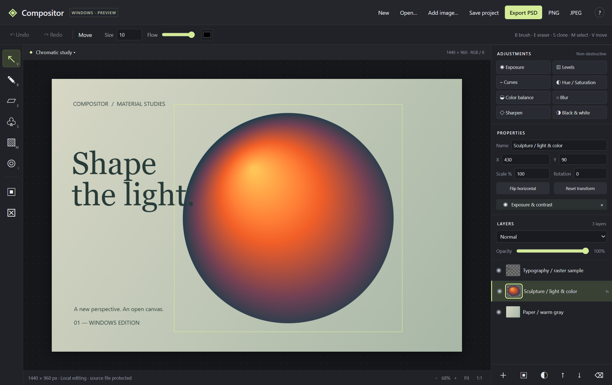

# Compositor Windows

**基于 [Robbie Tilton](https://github.com/robbietilton) 的 [Compositor](https://github.com/robbietilton/Compositor) 改写的非官方 Windows 图像编辑器。**

> 原项目由 Robbie Tilton 开发，原始版权属于 **Wonder Assembly LLC**，采用 MIT 许可证。本仓库保留原版源码、Git 历史及版权声明；Windows 客户端是由 [huaixu40](https://github.com/huaixu40) 维护的独立改写，使用 Electron / Canvas 实现。**本项目不是原作者官方发布，也未获得原作者背书。**
>
> An unofficial Windows adaptation of [Compositor by Robbie Tilton](https://github.com/robbietilton/Compositor). The original macOS source and MIT copyright are preserved. The Windows client is a separate Electron/Canvas implementation, not an official release or a feature-complete port.

[下载 Windows 预览版](https://github.com/huaixu40/Compositor-Windows/releases/tag/windows-v0.1.0) · [Windows 详细说明](windows/README-WINDOWS.md) · [原版 README](README.upstream.md) · [许可证](LICENSE)



## 这是什么

Compositor 原版是基于 SwiftUI、AppKit、CoreGraphics / CoreImage / Metal 的 macOS 图像编辑器，不能直接在 Windows 上编译运行。本仓库保留原版工程，并在 `windows/` 中新增 Windows 客户端，优先实现 **PSD 图层编辑和常用修图工作流**。

当前版本为 **0.1.0 Preview**。它已能在 Windows 上独立启动、打开图片、编辑图层并保存，但还没有完整复现原版或 Photoshop 的全部功能。以下功能与限制描述的是 Windows 版，不应与原版功能列表混用。

## 下载与启动

1. 打开 [Windows v0.1.0 预发布页面](https://github.com/huaixu40/Compositor-Windows/releases/tag/windows-v0.1.0)。
2. 下载 `Compositor-Windows-0.1.0-win-x64.zip`，解压到可写目录。
3. 双击解压目录中的 `Compositor-Windows.exe`。

便携包自带运行时，无需安装 Node.js、Python 或 Xcode，正常编辑不需要联网。**请保留整个解压目录，不要只复制 exe。** 当前提供 Windows x64 构建；已在开发者的 Windows 电脑验证，尚未覆盖不同设备的兼容性测试。预览版未做代码签名。

## 已实现的功能

| 范围 | 当前功能 |
|---|---|
| 文件 | 打开 8-bit RGB PSD、PNG、JPEG、WebP；导出分层 PSD、PNG、JPEG |
| 图层 | PSD 图层组、顺序、复制、删除、重命名、显隐、透明度、常见混合模式 |
| 变换 | 移动、缩放、旋转、水平翻转 |
| 蒙版 | 栅格蒙版导入/导出，黑白画笔编辑，启用/禁用 |
| 修图工具 | 画笔、橡皮、仿制图章、矩形选区、填充、吸管 |
| 可回改滤镜 | 曝光/对比度、色阶、RGB 曲线、色相/饱和度、色彩平衡、模糊、锐化、黑白 |
| 工作项目 | `.cwin` 保存图层原始像素、蒙版、变换及可编辑滤镜 |
| 编辑保护 | 撤销/重做、未保存提醒、PSD 转换报告、源文件覆盖保护 |

建议先保存 `.cwin` 工作项目，再导出 PSD 副本。PSD 导出会把本客户端的滤镜和变换烘焙到各个像素图层；原始滤镜参数保留在 `.cwin` 中。

## PSD 兼容性：请先了解

- **支持读写**：普通像素图层、层级、偏移、显隐、透明度、常见混合模式、栅格蒙版。
- **保留参数、近似预览**：PSD 的 Levels、Curves、Exposure、Invert 调整图层；当前没有这些导入调整层的参数编辑面板。
- **转换为缓存像素**：文字、智能对象、矢量内容，不保留原来的可编辑语义。
- **提示后转换或丢弃**：复杂图层效果、剪贴关系、其他调整图层、Blend If 和部分特殊遮罩/画板。需要保留文件存储的原始观感时，可选择 `Open merged preview` 以单层打开。
- **暂不支持**：CMYK、16/32-bit PSD、PSB、原版 `.comp` 项目、完整 ICC 色彩管理。

本版不会静默承诺完整兼容 Photoshop；已识别的兼容性问题会在导入时展示。**未完成 Adobe Photoshop 实机互操作验收，也不保证与 Photoshop 逐像素一致。** 请保留源文件，并优先用副本验证自己的工作流。

## 暂未移植

原版 GPU 渲染管线、Camera Raw、内容识别修复、自动抠图、可编辑文字、钢笔路径、自由扭曲和完整高级图层效果等尚未实现。大图及多层实时处理可能卡顿。详细容量限制和操作说明见 [Windows 使用说明](windows/README-WINDOWS.md)。

## 从源码运行

需要 Windows x64 和 Node.js 22.12 或更高版本。

```powershell
git clone https://github.com/huaixu40/Compositor-Windows.git
cd Compositor-Windows/windows
npm.cmd ci
npm.cmd start
```

构建和验证：

```powershell
npm.cmd test
npm.cmd run package
```

- `npm test` 在真实 Electron renderer 中执行测试，结果和界面截图写入 `windows/output/`。
- `npm run package` 生成 `windows/release/Compositor-Windows/` 和 `windows/Start-Compositor.cmd`。
- 打包器拒绝覆盖已有同名发布目录，重新打包前请先归档旧目录。
- 二进制与依赖目录不进入 Git 源码历史，便携包通过 GitHub Releases 提供。

## 验证记录

2026-10-16，源码版和已打包的 Windows exe 均通过 **14 项测试**，覆盖 PSD 往返、图层组/蒙版/偏移、调整参数保留、两份公开 PSD 样本、项目保存、滤镜、撤销/重做、工具交互和实际 IPC 文件读写/源文件覆盖保护。

[查看本地验证报告](docs/windows/validation-v0.1.0.json)。这些测试验证本版支持的表示和转换行为，不构成所有 PSD 文件或 Photoshop 完整兼容的保证。

## 目录说明

```text
Compositor/              原版 macOS Swift 源码
Compositor.xcodeproj/    原版 Xcode 工程
CompositorTests/         原版测试
windows/                Windows 客户端、构建脚本和测试样本
docs/windows/           Windows 截图与验证记录
README.upstream.md      基线版本的原版 README
LICENSE                 原作者 MIT 许可证与版权声明
```

原版 macOS 代码和 `.comp` schema 没有因 Windows 实现而修改。原版构建方式请阅读 [原版 README](README.upstream.md)。

## 原作者、致谢与许可证

- **原作者：Robbie Tilton** — [GitHub](https://github.com/robbietilton) · [Compositor 原仓库](https://github.com/robbietilton/Compositor)
- **原始版权：Copyright (c) 2026 Wonder Assembly LLC**。完整 MIT 声明保留于 [LICENSE](LICENSE)，便携包中另附 `COMPOSITOR-LICENSE.txt`。
- **原版基线：** [`365b5745eda537f984f3d5bed1e53c361dbc9c91`](https://github.com/robbietilton/Compositor/commit/365b5745eda537f984f3d5bed1e53c361dbc9c91)。
- **Windows 改写与维护：** [huaixu40](https://github.com/huaixu40)。此改写继续按 MIT 许可证提供，不替代或移除原版权声明。
- **PSD 读写：** [ag-psd](https://github.com/Agamnentzar/ag-psd) 31.0.3（MIT）。公开测试样本的来源与校验值见 [fixtures 说明](windows/test/fixtures/README.md)。
- **桌面运行时：** [Electron](https://github.com/electron/electron) 44.8.0。便携包保留其许可证和 Chromium 第三方许可；其他运行依赖的许可列于 `THIRD-PARTY-NOTICES.txt`。

感谢原作者公开 Compositor 的源码与设计，让 Windows 改写工作有了参考基础。
