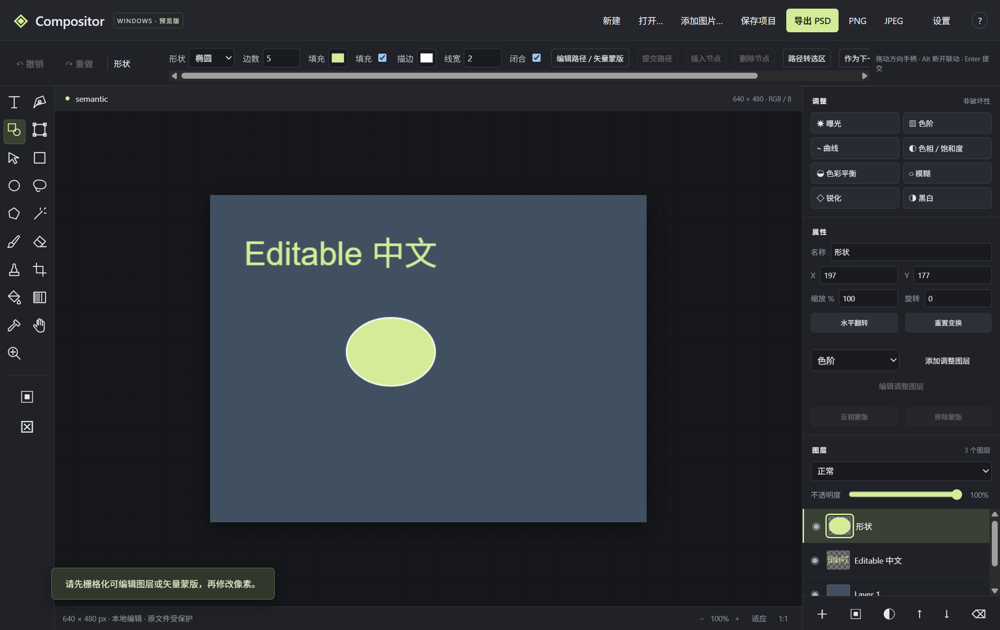
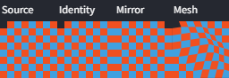

# Compositor Windows 0.5 验证记录

日期：2026-10-30。环境：本机 Windows x64、Electron 44.8.0、NVIDIA Lovelace WebGPU。阶段范围为文字、路径、形状、自由变换及受限 PSD 参数往返。

## 验证方法

使用真实 Electron 窗口，Playwright 发送鼠标及键盘事件创建文字、段落、形状、钢笔节点、控制点、选区与图层操作。内部接口仅用于样本建立、数据断言及独立计算/格式检查；文件往返经桌面保存/打开接口执行，测试替换文件选择对话框以指定隔离输出路径。

项目输出均在隔离测试目录。系统剪贴板测试保存并恢复原内容。原文件保护有拒绝覆盖检查。基础回归中出现的无效语言和源文件覆盖错误为预期拒绝场景。

## 结果文件

源码与便携版分别通过以下四套检查，每版 101 项、失败 0 项。构建文件一致性见 [package-v0.5.0.json](package-v0.5.0.json)：

| 检查 | 数量 | 源码记录 | 便携记录 |
|---|---:|---|---|
| 像素、PSD、项目、IPC 回归 | 21 | [source](validation-source-v0.5.0.json) | [portable](validation-v0.5.0.json) |
| 基础鼠标、键盘、右键、剪贴板 | 14 | [source](interaction-source-v0.5.0.json) | [portable](interaction-portable-v0.5.0.json) |
| GPU/CPU、故障回退、v1/v2、取消 | 44 | [source](render-source-v0.5.0.json) | [portable](render-portable-v0.5.0.json) |
| 文字、路径、变形及 PSD | 22 | [source](semantic-source-v0.5.0.json) | [portable](semantic-portable-v0.5.0.json) |

新增检查覆盖：文本输入及组合事件保护、取消、撤销/重做、段落溢出与缺字提示、栅格化保护、四种形状、贝塞尔手柄与增删节点、路径转选区/矢量蒙版、变换取消与一次撤销、透视/网格保留原图、重置与撤销、真实文件保存重开、PSD 文字/路径/蒙版往返、导出转换报告取消、复杂多样式文字降级、无效变形和错误原蒙版尺寸拒绝。

## 可检查图像

[像素结果](warp-quality-v0.5.0.json)：64×64 棋盘样本恒等与镜像最大通道差为 0；网格位移改变纹理；透明颜色测试采用预乘透明度插值，验证可见红色边缘不混入完全透明蓝色像素。该样本验证插值与透明度，不代表所有照片的主观质量。

## 边界与未完成验收

- 中文使用实际 insertText 输入，组合保护通过 DOM composition 事件验证；**Windows 原生输入法候选窗完整流程未完成验收**。
- **未完成 Photoshop 实机互操作验收**。本地使用 ag-psd 写入/读取，受支持结构和转换边界见 [操作说明](EDITING-0.5.md)。
- 网格是 3×3 分片仿射实现，像素预览在松开拖动后更新；不宣称完整 Photoshop 网格变形。
- GPU/CPU 保留既有透明度、混合模式、滤镜及旋转边缘对照与故障回退测试。0.4 的 1080p 五层性能样本是历史基线，不等于 0.5 所有高级变形达到 30 FPS。0.5 尚未新增完整帧率、内存和显存性能验收。
- RAW、修复和自动抠图图像质量验收随 0.6 实现；十类效果及完整 PSD 整合随 0.7 实现。尚不支持 PSB、CMYK、16/32-bit PSD 或完整色彩管理。
- 原始 macOS 源码、版权声明和旧版本保留。阶段为预览交付，不代表整体升级计划完成。
